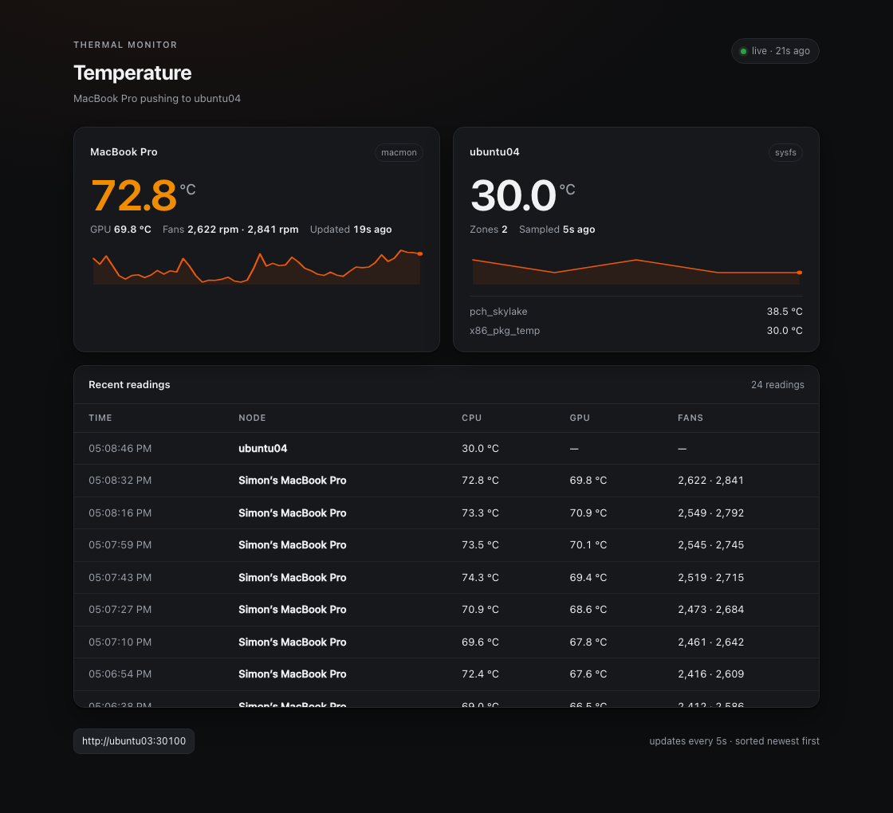

# Thermal Monitor

A small Rust app that reports the temperature of my MacBook Pro and the server it runs on. The Mac pushes readings over Tailscale; the server keeps the latest sample and serves a dashboard.

**Dashboard:** http://ubuntu03:30100/ (tailnet) · **Gallery:** https://projects.navonsimon.com/



## How it works

```
MacBook Pro (launchd)                    ubuntu04 pod (Kubernetes)
┌───────────────────────┐   POST /api/report   ┌──────────────────────────┐
│ thermal push          │ ───────────────────► │ thermal serve            │
│  macmon → CPU/GPU/fans│   every 15 s         │  in-memory history       │
└───────────────────────┘   X-Thermal-Token    │  GET /api/temps          │
                                               │  GET /     (dashboard)   │
                                               │  /sys/class/thermal      │
                                               └──────────────────────────┘
```

- `serve` reads Linux thermal zones on every poll and stores pushed Mac readings in memory (no database).
- `push` samples the Mac with [`macmon`](https://github.com/vladkens/macmon) and posts the result; the token is read from a `0600` file.
- The dashboard is a single inline HTML/CSS/JS page served by the same binary, refreshed every 5 seconds.
- Only one replica: history is in memory, so a restart starts fresh.

## Endpoints

| Method | Path         | Purpose                                   |
|--------|--------------|-------------------------------------------|
| GET    | `/`          | Dashboard                                 |
| GET    | `/api/temps` | Latest Mac + server readings and history  |
| POST   | `/api/report`| Mac push (`x-thermal-token` required)     |
| GET    | `/healthz`   | Health probe                              |

## Run locally

```sh
cargo run -- serve                 # http://localhost:8080
cargo run -- read                  # one local sample as JSON
cargo run -- push --url http://localhost:8080/api/report --once
```

Server configuration: `BIND` (default `0.0.0.0:8080`), `HOST_LABEL`, `THERMAL_TOKEN`. Without `THERMAL_TOKEN` the report endpoint is unauthenticated.

## Deploy

The image is built on `ubuntu02` (Docker), pushed to the cluster's registry on `ubuntu04` through an SSH tunnel, and rolled out with `kubectl`.

```sh
# once: create the push token (keep it out of git)
kubectl -n thermal-monitor create secret generic thermal-token \
  --from-literal=token="$(openssl rand -hex 24)" --dry-run=client -o yaml | kubectl apply -f -

./deploy/deploy.sh            # build + push + rollout
kubectl -n thermal-monitor get pods
```

Exposed as NodePort **30100** and pinned to `ubuntu04` because the registry listens on its loopback. Reachable at `http://ubuntu03:30100/` over Tailscale.

## Mac collector

```sh
brew install macmon
cargo build --release
cp target/release/thermal-monitor bin/thermal
mkdir -p ~/.config/thermal-monitor
printf '%s' '<token>' > ~/.config/thermal-monitor/token
chmod 600 ~/.config/thermal-monitor/token
```

Then a `LaunchAgent` at `~/Library/LaunchAgents/com.simon.thermal-monitor.plist` runs:

```
bin/thermal push --url http://ubuntu03:30100/api/report \
  --token-file ~/.config/thermal-monitor/token --interval 15
```

```sh
launchctl bootstrap gui/$(id -u) ~/Library/LaunchAgents/com.simon.thermal-monitor.plist
```
